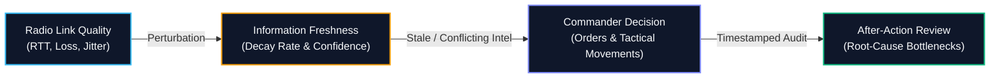
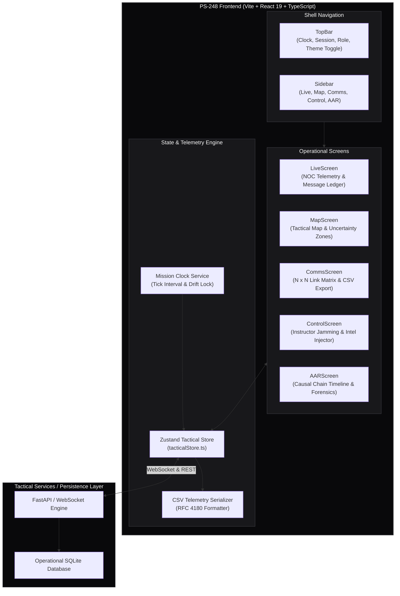
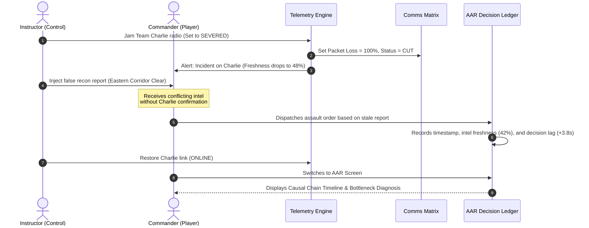
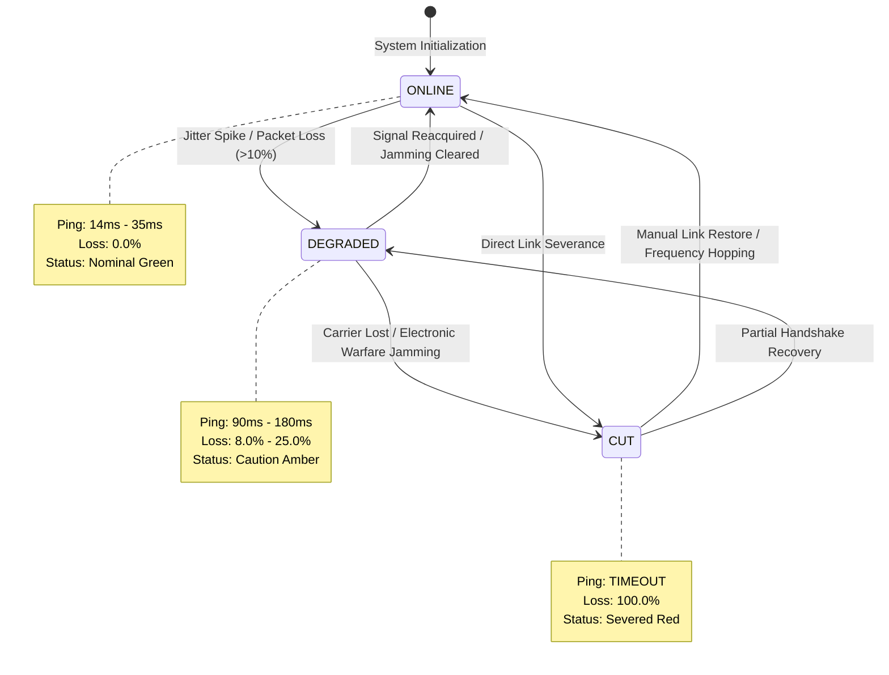
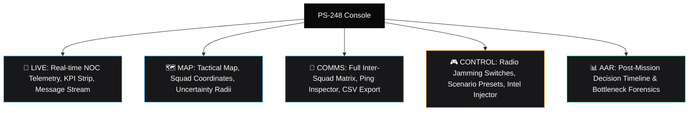

# PS-248: Resilient Tactical Communication & Decision-Training System

[](https://react.dev/)
[](https://www.typescriptlang.org/)
[](https://tailwindcss.com/)
[](tests/tactical.test.mjs)
[](.oxlintrc.json)
[](LICENSE)

> A real-time, engineering-grade tactical telemetry and decision-training web application modeled after high-reliability Network Operations Centers (**Datadog**, **Grafana Network Observability**, **Cloudflare Radar**, and **Linear**).

---

## Table of Contents

- [1. Executive Summary](#1-executive-summary)
- [2. The Causal Model](#2-the-causal-model)
- [3. System Architecture](#3-system-architecture)
- [4. Operational Flow & Data Lifecycle](#4-operational-flow--data-lifecycle)
- [5. Radio Link State Machine](#5-radio-link-state-machine)
- [6. Application Screens](#6-application-screens)
  - [Live Screen (Operational Telemetry & NOC HUD)](#-live-screen-operational-telemetry--noc-hud)
  - [Map Screen (Tactical Map & Channel Health)](#-map-screen-tactical-map--channel-health)
  - [Comms Screen (Communications Matrix & CSV Export)](#-comms-screen-communications-matrix--csv-export)
  - [Control Screen (Instructor Jamming & False Intel)](#-control-screen-instructor-jamming--false-intel)
  - [AAR Screen (Decision Timeline & Bottleneck Forensics)](#-aar-screen-decision-timeline--bottleneck-forensics)
- [7. Quickstart & How to Run](#7-quickstart--how-to-run)
- [8. Automated Verification & Testing](#8-automated-verification--testing)
- [9. Project Directory Layout](#9-project-directory-layout)

---

## 1. Executive Summary

In high-stakes tactical environments, standard messaging tools fail because they present a false binary: either a message is delivered, or it is not. 

In reality, communications experience:
* **Progressive Latency & Jitter** — Messages arrive, but late.
* **Packet Loss & Channel Jamming** — Intermittent drops that starve teams of synchronized telemetry.
* **Information Staleness** — Old operational pictures masquerading as current ground truth.
* **Adversarial / Conflicting Intel** — Injected false reports that contradict prior recon.

**PS-248** is an interactive simulation and decision-training platform that makes the **causal chain from network degradation to flawed command decisions measurable, observable, and reviewable**.

---

## 2. The Causal Model

The application models the direct cause-and-effect relationship between network link reliability, operational intelligence freshness, and commander decision speed:



* **Nominal State**: 18ms latency, 0% packet loss $\rightarrow$ 98% Intel Freshness $\rightarrow$ Decision Lag: 0.8s (High Confidence).
* **Degraded State**: 140ms latency, 15% loss $\rightarrow$ 58% Intel Freshness $\rightarrow$ Decision Lag: 2.4s (Caution Advised).
* **Severed / Jammed State**: Connection timeout $\rightarrow$ Staleness decay $< 40\%$ $\rightarrow$ Decision Lag: +4.8s (Operating on false/conflicted assumptions).

---

## 3. System Architecture

The frontend is architected as a reactive, zero-jitter telemetry application with modular screens, centralized Zustand state management, and real-time canvas-based rendering:



---

## 4. Operational Flow & Data Lifecycle

The sequence below illustrates a live training cycle where an instructor induces radio jamming, injects false recon intel, and analyzes the commander's resulting decision during the After-Action Review:



---

## 5. Radio Link State Machine

Each squad channel (**Headquarters**, **Team Alpha**, **Team Bravo**, **Team Charlie**) transitions across three deterministic operational states:



---

## 6. Application Screens

The frontend features 5 dedicated, high-density screens accessible via the left navigation sidebar:



### 🔵 Live Screen (Operational Telemetry & NOC HUD)
* **Contiguous KPI Metrics Strip**: Network Reliability %, Average RTT Ping (ms), Intel Freshness %, and Handled Messages with comparative deltas (`vs last min`).
* **Cloudflare Radar-Style Incident Banner**: Real-time status badge that immediately flags channel interruptions and calculated operational decision delay.
* **Grafana-Inspired Timeseries Canvas**: Dual-axis graph displaying Round-Trip Latency (ms) on the left axis, Packet Delivery % on the right axis, a dotted `90% SLA Target` line, and an interactive crosshair hover scrubber.
* **Chronological Message Ledger**: Datadog-style log table with rapid 1-click squad target chips (`To: [HQ] [Alpha] [Bravo] [Charlie]`).

### 🗺️ Map Screen (Tactical Map & Channel Health)
* **SVG Tactical Grid**: Real-time coordinates of squad positions (Alpha Recon, Bravo Assault, Charlie Fire Support).
* **Uncertainty Radii**: Circular uncertainty boundary that dynamically expands as channel packets drop or latency spikes, visualizing stale coordinate data.
* **Response Time Comparison**: Horizontal bar gauges tracking squad response pings against baseline.

### 💬 Comms Screen (Communications Matrix & CSV Export)
* **Complete $N \times N$ Link Matrix**: Inter-team routing grid showing active links between Headquarters, Alpha, Bravo, and Charlie.
* **Direct Metrics Table**: Source squad, destination squad, connection status, latency, delivery percentage, and intel quality.
* **RFC 4180 CSV Exporter**: 1-click export of session telemetry bundles for offline analysis.

### 🎮 Control Screen (Instructor Jamming & False Intel)
* **Radio State Toggles**: Immediate perturbation switches (`Online`, `Degraded`, `Severed`) for each team.
* **Adversarial False Intel Injector**: Form to inject fabricated situational reports with conflict probability weighting (10% to 100%).
* **Quick Scenario Presets**: Ready-to-inject mission scenarios (Ambush reports, corridor clearance, electronic warfare attacks).
* **Mission Clock Controls**: Pause, resume, reset, and tick forward.

### 📊 AAR Screen (Decision Timeline & Bottleneck Forensics)
* **Mission KPIs**: Total operational duration, overall delivery percentage, dropped packets, and average delay.
* **GitHub-Style Causal Decision Timeline**: Vertical milestone rail that maps the exact causal chain from link failures to player command dispatches.
* **Critical Bottleneck Diagnostic**: Automated root-cause report highlighting the specific radio link that triggered tactical failure.

---

## 7. Quickstart & How to Run

### Prerequisites
* **Node.js**: `v18.0.0` or higher (Node `v20+` recommended)
* **npm**: `v9.0.0` or higher
* **Python** (Optional, for backend): `3.10+` with FastAPI & Uvicorn

### 1. Installation
Clone the repository and install all dependencies:
```bash
git clone https://github.com/ghostknight10/SIH2.git
cd SIH2
npm install
```

### 2. Development Server
Start the local Vite development server with instant Hot Module Replacement (HMR):
```bash
npm run dev
```
Navigate to **`http://localhost:5173`** in your browser.

### 3. Start Python Backend (Optional)
To run the companion FastAPI + WebSocket telemetry server on `http://127.0.0.1:8000`:
```bash
npm run backend
# or: python backend/run.py
```
> The frontend auto-detects the backend. If offline, it smoothly defaults to the high-fidelity in-browser simulator.

### 4. Run Automated Test Suite
Run the 16 automated end-to-end and telemetry tests using Node's built-in test runner:
```bash
npm run test
```

### 5. Run Linter
Run Oxlint across all TypeScript and React components:
```bash
npm run lint
```

### 6. Production Build
Compile TypeScript and bundle the application for production deployment:
```bash
npm run build
```
The optimized bundle will be generated in the **`dist/`** directory.

---

## 8. Automated Verification & Testing

The test suite in [`tests/tactical.test.mjs`](file:///c:/Users/watas/OneDrive/Documents/Desktop/SIH2/tests/tactical.test.mjs) validates all core application requirements:

```
✔ R1 & R2: Screen Navigation Toggling across all 5 screens (Live, Map, Comms, Control, AAR)
✔ R2 & R3: Radio State Switches update metrics, node diagnostics, and uncertainty radii
✔ R2: Rapid concurrent radio state perturbations across all teams
✔ R2: Message Transmission dropped when receiver OR sender is severed
✔ R2: Adversarial False Intel Injector applies conflict probability weighting
✔ R2 & Acceptance Criteria: CSV Export produces valid RFC 4180 telemetry bundle
✔ R2: Comms search query matches severed, degraded, online, and status filters
✔ R2: Scenario Reset restores all telemetry to baseline
✔ R1 & R2: Session clock progresses forward without jumping backward
✔ R2: Background clock ticks preserve false intel freshness degradation
✔ R2: Unique IDs guaranteed on rapid concurrent actions
✔ R2 & Acceptance Criteria: exportTelemetryCSV returns valid RFC 4180 CSV safely in Node
✔ R1 & R2: Session clock wraps smoothly past 24:00:00 without producing hour 24
✔ R2: Loopback transmission to self is rejected
✔ R2: Radio status toggling preserves active false intel degradation
✔ R1 & R2: Timeline initial entries use consistent 14:xx:xx format matching clock

16 tests passed · 0 failed · 0 warnings
```

---

## 9. Project Directory Layout

```
SIH2/
├── backend/                # FastAPI + WebSocket server & degradation engine
│   ├── app/
│   │   ├── main.py         # REST & WebSocket API endpoints
│   │   └── engine.py       # Latency, loss & freshness simulation physics
│   ├── requirements.txt    # Python dependencies
│   └── run.py              # 1-click launcher script
├── public/                 # Static assets and icons
├── src/
│   ├── components/
│   │   ├── Layout/         # TopBar, Sidebar navigation, UtilityToolbar
│   │   ├── Telemetry/      # PerformanceCharts (Dual-axis RTT & SLA canvas)
│   │   ├── Map/            # TacticalMap (SVG coordinates & uncertainty radii)
│   │   ├── Comms/          # DispatchLedger, CommsMatrix
│   │   ├── Screens/        # 5 Core Application Screens:
│   │   │   ├── LiveScreen.tsx
│   │   │   ├── MapScreen.tsx
│   │   │   ├── CommsScreen.tsx
│   │   │   ├── ControlScreen.tsx
│   │   │   └── AARScreen.tsx
│   ├── store/              # tacticalStore.ts (Zustand state engine)
│   ├── services/           # types.ts, websocket.ts (Auto-discovery client), csvExport.ts
│   ├── index.css           # Tailwind CSS v4 & theme variables
│   ├── App.tsx             # Root application orchestrator
│   └── main.tsx            # React 19 entry point
├── tests/                  # tactical.test.mjs (16 automated tests)
├── .gitignore              # Ignored builds, node_modules, and internal plan docs
├── package.json            # Scripts and dependencies
├── tsconfig.json           # TypeScript configuration
└── vite.config.ts          # Vite bundler configuration
```

---

*PS-248 — Making Communication Failure Visible.*
