# PS-248 — Resilient Tactical Communication & Decision Training System

**Frontend Repository**

---

## Table of Contents

1. [Overview](#overview)
2. [The Core Concept](#the-core-concept)
3. [Architecture](#architecture)
4. [User Roles](#user-roles)
5. [Navigation Structure](#navigation-structure)
6. [Feature Breakdown](#feature-breakdown)
7. [UI Screens](#ui-screens)
8. [Design System](#design-system)
9. [Build Order & Timeline](#build-order--timeline)
10. [Demo Flow](#demo-flow)
11. [Tech Stack](#tech-stack)
12. [Getting Started](#getting-started)
13. [Project Status](#project-status)

---

## Overview

PS-248 is a **real-time tactical communication and decision-training simulation platform**.

It simulates a scenario where multiple teams need to communicate and make decisions while their communication network experiences realistic degradation:

- ⏱️ **Delay** — Messages take time to deliver
- 🚫 **Drops** — Messages may never arrive
- 📡 **Radio failures** — Teams lose connectivity
- 🔄 **Reconnection** — Teams regain communication
- 🎭 **False information** — Conflicting or injected reports
- 📊 **Information degradation** — Quality metrics show reliability

### The Key Insight

> **When communication becomes unreliable, information becomes delayed or less trustworthy, which affects decisions.**

---

## The Core Concept

The system models the **causal chain** that connects communication to decision-making:

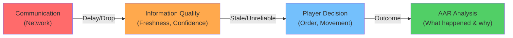

**Unlike a basic messaging app:**

- ✗ Not just tracking: "Message delivered."
- ✓ **Actually tracking:** "Message arrived, but information is 42% stale and confidence is low."
- ✓ **Connecting:** Communication events → Information quality → Player decisions
- ✓ **Analyzing:** Why did the player make that decision? What communication issues contributed?

---

## Architecture

### System-Level View

```mermaid
graph TB
    subgraph Client["Frontend Layer"]
        A["🎮 Instructor UI"]
        B["👥 Player UI"]
        C["🗺️ Tactical Map"]
        D["💬 Communication Panel"]
        E["📋 AAR Dashboard"]
    end
    
    subgraph Backend["Backend Layer - FastAPI + WebSockets"]
        F["Session Manager"]
        G["Message Broker"]
        H["World State"]
        I["Event Logger"]
        J["Information Quality Calculator"]
    end
    
    subgraph Storage["Persistence"]
        K["SQLite DB"]
    end
    
    Client -->|HTTP/WS| Backend
    Backend --> Storage
    K -->|Historical Data| E
    
    style Client fill:#1a1b1e
    style Backend fill:#2c2d31
    style Storage fill:#3c3d41
```

### Data Flow During Session

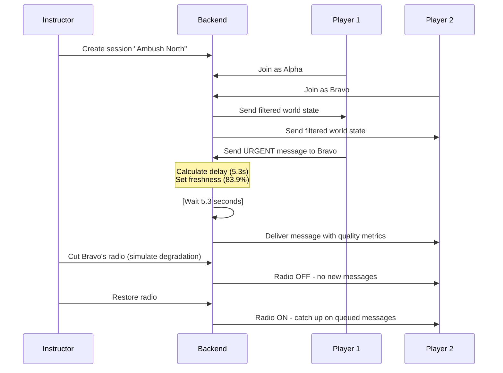

---

## User Roles

### 🎮 Instructor

The instructor controls the simulation and observes everything.

**Can see:**
- ✅ Full world state (all teams, all units, all information)
- ✅ All communication (sent, delivered, dropped, delayed)
- ✅ Real-time communication health
- ✅ Player decisions
- ✅ Timed events and triggers

**Can do:**
- ✅ Create & start sessions
- ✅ Pause/resume simulation
- ✅ Control team radios (cut/restore)
- ✅ Inject conflicting information
- ✅ Trigger scenario events
- ✅ View AAR
- ✅ Monitor session clock

**Cannot:**
- ❌ See student names or personal data beyond role

### 👥 Player

Players operate with only the information available to their team.

**Can see:**
- ✅ Their assigned team's state
- ✅ Allowed units and objectives
- ✅ Messages received by their team
- ✅ Communication quality indicators
- ✅ Their team's radio status
- ✅ Information freshness/confidence metrics

**Can do:**
- ✅ Send messages to other teams
- ✅ Issue orders/decisions
- ✅ Observe communication delays and drops
- ✅ See message priorities
- ✅ Receive AAR after session (optional)

**Cannot:**
- ❌ See other teams' information
- ❌ Access instructor controls
- ❌ Manipulate world state
- ❌ See the "truth" before it's communicated

---

## Navigation Structure

### Player Navigation

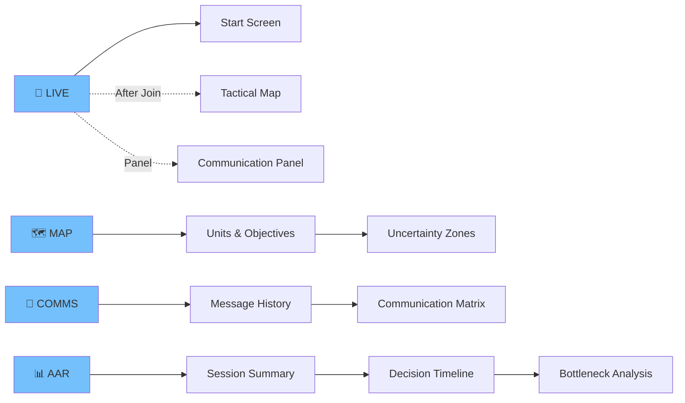

### Instructor Navigation

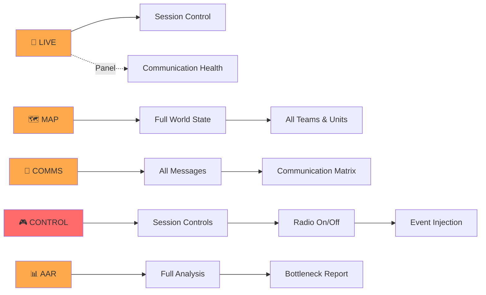

---

## Feature Breakdown

### Core Features (MVP)

| Feature | Description | Player | Instructor | Priority |
|---------|-------------|--------|-----------|----------|
| **Authentication** | Login & session join | ✅ | ✅ | P0 |
| **Live Map** | Tactical map with unit positions | ✅ | ✅ | P0 |
| **Messaging** | Send/receive messages | ✅ | ✅ | P0 |
| **Message Priority** | URGENT / HIGH / NORMAL / LOW badges | ✅ | ✅ | P0 |
| **Communication Status** | Show delay, drop rate, radio status | ✅ | ✅ | P0 |
| **Radio Control** | Instructor can cut/restore radios | ❌ | ✅ | P0 |
| **AAR Dashboard** | Summary, events, timeline | ✅ | ✅ | P0 |

### Standout Features (P1)

| Feature | Description | Player | Instructor | Priority |
|---------|-------------|--------|-----------|----------|
| **Information Freshness** | Visual freshness/confidence indicator | ✅ | ✅ | P1 |
| **Communication Matrix** | Team-to-team health heatmap | ✅ | ✅ | P1 |
| **Uncertainty Visualization** | Faded/dashed unit markers for old info | ✅ | ✅ | P1 |
| **Event Feed** | Real-time event stream | ✅ | ✅ | P1 |
| **Decision Timeline** | Connect comms → decisions | ✅ | ✅ | P1 |
| **Bottleneck Detection** | Auto-identify problem links | ✅ | ✅ | P1 |
| **Event Injection** | Instructor injects false reports | ❌ | ✅ | P1 |

### Polish & UX (P2)

| Feature | Description | Priority |
|---------|-------------|----------|
| **Connection State** | Visual indicator for connected/reconnecting/offline | P2 |
| **Loading States** | Spinners and skeleton screens | P2 |
| **Empty States** | Helpful messaging when no data | P2 |
| **Toast Notifications** | Non-blocking alerts | P2 |
| **Confirmation Dialogs** | Protect destructive instructor actions | P2 |
| **Responsive Layout** | Works on mobile/tablet/desktop | P2 |
| **Keyboard Shortcuts** | Faster workflow | P2 |
| **Micro-animations** | Subtle transitions & feedback | P2 |

---

## UI Screens

### 1. LIVE Screen (Default)

The main operational interface.

```mermaid
graph TB
    subgraph TopBar["TOP BAR"]
        S1["Session: Ambush North"]
        S2["Clock: 14:32"]
        S3["Status: 🟢 CONNECTED"]
        S4["Role: Player / Instructor"]
    end
    
    subgraph Main["MAIN VIEW"]
        subgraph Sidebar["SIDEBAR"]
            N1["🔵 LIVE"]
            N2["🗺️ MAP"]
            N3["💬 COMMS"]
            N4["🎮 CONTROL"]
            N5["📊 AAR"]
        end
        
        subgraph MapArea["TACTICAL MAP"]
            M1["Team Positions"]
            M2["Unit Markers"]
            M3["Objectives"]
            M4["Uncertainty Zones"]
        end
        
        subgraph CommPanel["COMMS PANEL"]
            C1["Message List"]
            C2["Priority Badges"]
            C3["Delay Indicators"]
            C4["Freshness Bar"]
        end
    end
    
    subgraph EventFeed["EVENT FEED"]
        E1["🔊 Radio status changed"]
        E2["✉️ Message delivered"]
        E3["⚠️ Radio degraded"]
    end
    
    style TopBar fill:#111820
    style Sidebar fill:#111820
    style MapArea fill:#0B0F14
    style CommPanel fill:#111820
    style EventFeed fill:#0B0F14
```

### 2. COMMS Screen

Communication matrix and message history.

```mermaid
graph TB
    subgraph Matrix["COMMUNICATION MATRIX"]
        T1["             ALPHA    BRAVO    CHARLIE"]
        T2["ALPHA          —       🟢        🟡"]
        T3["BRAVO         🟢        —        🔴"]
        T4["CHARLIE       🟡       🔴         —"]
    end
    
    subgraph MessageTable["MESSAGE HISTORY"]
        M1["URGENT | Alpha → Bravo | 5.26s delay | ✅ Delivered"]
        M2["HIGH   | Bravo → Charlie | 8.12s delay | ❌ Dropped"]
        M3["NORMAL | Alpha → Charlie | 2.30s delay | ✅ Delivered"]
    end
    
    subgraph Legend["LEGEND"]
        L1["🟢 Healthy | 🟡 Degraded | 🔴 Cut | ⚪ Unknown"]
    end
    
    style Matrix fill:#111820
    style MessageTable fill:#111820
    style Legend fill:#26313D
```

### 3. CONTROL Screen (Instructor Only)

Session and communication controls.

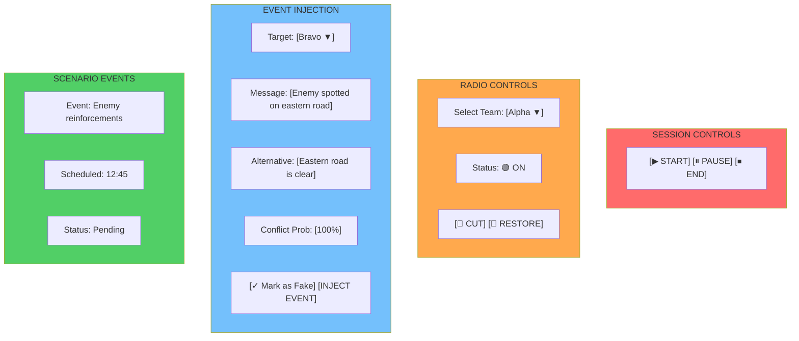

### 4. AAR Screen

After-action review and analysis.

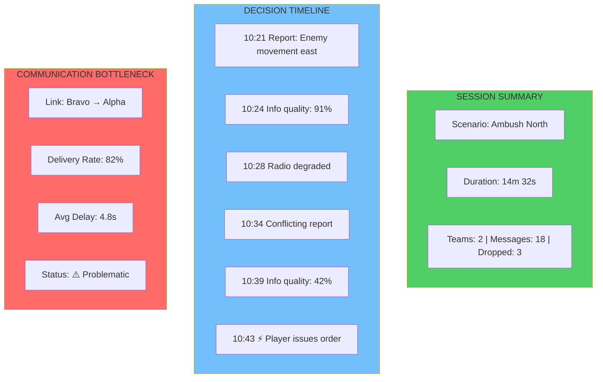

---

## Design System

### Visual Tokens

```css
/* Colors */
--bg-primary:      #0B0F14    /* Main background */
--bg-secondary:    #111820    /* Panel background */
--border:          #26313D    /* Borders & dividers */
--text-primary:    #E6EDF3    /* Main text */
--text-muted:      #8B98A7    /* Secondary text */

/* Status Colors */
--status-success:  #51cf66    /* Green */
--status-warning:  #ffa94d    /* Amber */
--status-danger:   #ff6b6b    /* Red */
--status-info:     #74c0fc    /* Blue */

/* Typography */
--font-family:     Inter, Geist, sans-serif
--font-mono:       JetBrains Mono, monospace

--font-size-xs:    12px
--font-size-sm:    14px
--font-size-md:    16px
--font-size-lg:    18px
--font-size-xl:    20px
```

### Component Examples

#### Message Badge (Priority)

```
┌─────────────────────────────────────┐
│ 🔴 URGENT                           │
│ Enemy spotted east road             │
│ Delivered after 5.3s · Conf: 84%   │
└─────────────────────────────────────┘
```

#### Information Quality Indicator

```
Information Quality
████████░░ 84%

Status: FRESH
Confidence: 84%
Freshness: 83.9%
```

When stale:

```
Information Quality
███░░░░░░░ 31%

Status: STALE
Confidence: 31%
Freshness: 15%
```

#### Uncertainty Marker (Map)

```
        . . . . . .
      .             .
     .      ?        .
      .             .
        . . . . . .
```

### Animation Guidelines

✅ **Do:**
- Slide in new messages
- Fade radio status changes
- Pulse alert indicators
- Subtle opacity shifts on map

❌ **Don't:**
- Bounce or excessive movement
- Large spinning transitions
- Decorative flourishes
- Constant motion

**Principle:** The UI should feel **operational, not playful**.

---

## Build Order & Timeline

### Phase 0: MVP (P0) — 3 Days

**Focus:** Functional end-to-end system.

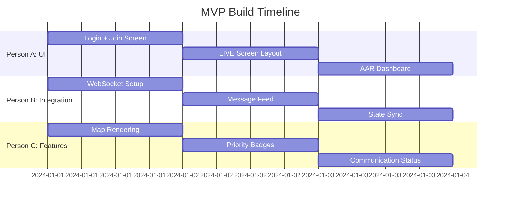

**Deliverables:**
- [ ] Functional login
- [ ] Playable session join
- [ ] Working tactical map
- [ ] Real-time message delivery
- [ ] Message priority display
- [ ] Radio status indicator
- [ ] Basic AAR page
- [ ] Player/Instructor separation

**Success Metric:** End-to-end demo without crashing.

---

### Phase 1: Standout (P1) — Next Sprint

Add the features that make the project special.

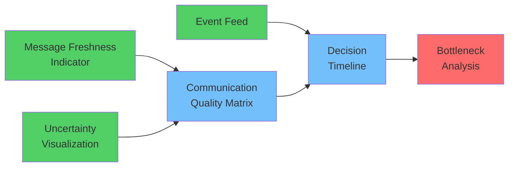

**Priority Features:**
1. Information freshness/confidence bars
2. Communication matrix heatmap
3. Uncertainty visualization on map
4. Event feed with filtering
5. Decision timeline (AAR)
6. Bottleneck detection (AAR)
7. Event injection (Instructor)

---

### Phase 2: Polish (P2) — Final Sprint

Quality and UX.

- Connection state indicator
- Loading states
- Empty states
- Error messages
- Responsive design
- Keyboard shortcuts
- Animations
- Testing

---

## Demo Flow

### 👉 The 9-Step Demo (8 Minutes)

This flow shows the causal chain that makes the project special.

**Step 1: Session Creation**
- Instructor creates session "Ambush North"
- Two players connect (Alpha, Bravo)

**Step 2: Normal Message**
- Alpha sends normal message to Bravo
- ✅ Delivered normally (2-3s)
- Show freshness: 99%, confidence: 99%

**Step 3: Priority Message**
- Alpha sends URGENT message to Bravo
- Show URGENT badge
- ⏱️ Note: URGENT might behave differently (faster priority)

**Step 4: Radio Degradation**
- Instructor cuts Bravo's radio
- Show in real-time: "🔴 RADIO OFF"
- Bravo sees: "Cannot receive messages"

**Step 5: Message Queue**
- Alpha keeps sending (to demonstrate queue)
- Messages pile up

**Step 6: Radio Restore**
- Instructor restores Bravo's radio
- Show: "🟢 RADIO ON"
- Bravo catches up on queued messages
- Note delays: 5.3s, 8.1s, etc.

**Step 7: Inject Conflicting Info**
- Instructor injects: "No enemy activity"
- Alpha previously reported: "Enemy spotted east"
- Show information quality drop:
  - Freshness: 84% → 42%
  - Confidence: 84% → 42%
  - Status: FRESH → **STALE & CONFLICTED**

**Step 8: Player Decision**
- Player issues order based on available information
- Log decision with timestamp

**Step 9: AAR Analysis**
- Open AAR dashboard
- Show the chain:

```
10:21  Message received
       "Enemy spotted east"
       ✅ Quality: 91%

10:28  Radio degraded
       📡 Connection lost

10:34  Conflicting report injected
       "No enemy activity"
       ⚠️ Quality dropped to 42%

10:43  ⚡ PLAYER ISSUED ORDER
       (Based on conflicted information)
```

- Highlight: **Communication → Information Quality → Decision**
- Bottleneck report: "Bravo's radio was the critical link"

---

## Tech Stack

### Frontend

```mermaid
graph LR
    A["React 18"] --> B["TypeScript"]
    C["Vite"] --> A
    D["TailwindCSS"] --> A
    E["Shadcn/ui"] --> A
    F["WebSocket<br/>Client"] --> A
    G["Zustand<br/>State"] --> A
    
    style A fill:#61dafb
    style B fill:#3178c6
    style C fill:#9400d3
    style D fill:#06b6d4
    style E fill:#0f172a
    style F fill:#fbbf24
    style G fill:#ec4899
```

### Backend (Provided)

- **Python** FastAPI
- **WebSockets** for real-time
- **SQLite** for persistence
- **JWT** for auth

### Build & Deployment

- **Vite** for bundling
- **Docker** for containerization
- **GitHub** for version control

---

## Getting Started

### Prerequisites

- Node.js 18+
- npm or yarn
- Backend running on `http://localhost:8000`

### Installation

```bash
# Clone the repository
git clone https://github.com/your-org/PS248-Frontend.git
cd PS248-Frontend

# Install dependencies
npm install

# Start development server
npm run dev

# Open browser to http://localhost:5173
```

### Environment Setup

Create `.env.local`:

```
VITE_BACKEND_URL=http://localhost:8000
VITE_WS_URL=ws://localhost:8000/ws
VITE_API_KEY=your_dev_key
```

### Running the Demo

```bash
# Terminal 1: Start backend
cd ../backend
python -m uvicorn app.main:app --reload

# Terminal 2: Start frontend
cd frontend
npm run dev

# Terminal 3: Run simulator (optional)
cd ../backend
python scripts/simulate_clients.py
```

---

## Project Structure

```
frontend/
├── src/
│   ├── components/
│   │   ├── Auth/
│   │   │   └── LoginForm.tsx
│   │   ├── Layout/
│   │   │   ├── Sidebar.tsx
│   │   │   └── TopBar.tsx
│   │   ├── Live/
│   │   │   ├── TacticalMap.tsx
│   │   │   └── CommunicationPanel.tsx
│   │   ├── Comms/
│   │   │   ├── CommunicationMatrix.tsx
│   │   │   └── MessageHistory.tsx
│   │   ├── Control/
│   │   │   ├── SessionControls.tsx
│   │   │   ├── RadioControls.tsx
│   │   │   └── EventInjection.tsx
│   │   ├── AAR/
│   │   │   ├── SessionSummary.tsx
│   │   │   ├── DecisionTimeline.tsx
│   │   │   └── BottleneckAnalysis.tsx
│   │   └── Common/
│   │       ├── EventFeed.tsx
│   │       ├── MessageBadge.tsx
│   │       └── FreshnessIndicator.tsx
│   ├── hooks/
│   │   ├── useWebSocket.ts
│   │   ├── useSession.ts
│   │   └── useAuth.ts
│   ├── store/
│   │   ├── sessionStore.ts
│   │   ├── messagesStore.ts
│   │   └── authStore.ts
│   ├── services/
│   │   ├── api.ts
│   │   ├── websocket.ts
│   │   └── types.ts
│   ├── pages/
│   │   ├── Login.tsx
│   │   ├── SessionJoin.tsx
│   │   ├── Live.tsx
│   │   ├── Map.tsx
│   │   ├── Comms.tsx
│   │   ├── Control.tsx
│   │   └── AAR.tsx
│   ├── App.tsx
│   └── main.tsx
├── public/
│   └── assets/
├── package.json
├── tsconfig.json
├── vite.config.ts
└── tailwind.config.js
```

---

## Project Status

### ✅ Backend (Complete)

- [x] FastAPI server
- [x] WebSocket support
- [x] Message routing & delivery
- [x] Delay/drop simulation
- [x] Radio controls
- [x] Information quality metrics
- [x] AAR generation
- [x] Bottleneck detection
- [x] Decision tracking
- [x] Full test coverage

### 🚀 Frontend (Active Development)

**Phase 0 (MVP) - Current**
- [ ] Authentication & login
- [ ] Session join/creation
- [ ] LIVE screen with map
- [ ] WebSocket integration
- [ ] Message display
- [ ] Radio status
- [ ] Basic AAR

**Phase 1 (Standout)**
- [ ] Freshness indicators
- [ ] Communication matrix
- [ ] Uncertainty visualization
- [ ] Event feed
- [ ] Decision timeline
- [ ] Bottleneck analysis

**Phase 2 (Polish)**
- [ ] Responsive design
- [ ] Loading states
- [ ] Error handling
- [ ] Animations
- [ ] Testing

---

## Key Design Principles

### 1. **Clarity Over Complexity**

The UI should be understandable at a glance.

```
Bad:  [ Complex state JSON dump ]
Good: [ 🟢 CONNECTED · 4.8s avg delay · 82% delivered ]
```

### 2. **Information Hierarchy**

Core information is always visible. Details are one click away.

```
VISIBLE:     URGENT | Message text | 5.3s | 84% confidence
ONE CLICK:   ID | Sender | Receiver | Sent | Delivered | Tampered
```

### 3. **Role Separation**

Players and instructors see completely different interfaces.

```
Player View:   Filtered state only (your team's info)
Instructor:    Full state (all teams, all info, all controls)
```

### 4. **Operational Feel**

The UI should feel like a military command center, not a generic dashboard.

- Dark theme
- High contrast
- Minimal decoration
- Status indicators
- Clear affordances

### 5. **Causality Display**

The project's core idea is the **causal chain**. Make it visible.

```
Communication Degrades
          ↓
Information Quality Drops
          ↓
Player Makes Decision
          ↓
AAR Shows Why
```

---

## Important: Security & Information Filtering

**Critical:** Players must never see information they shouldn't know.

```mermaid
graph TB
    WS["🌍 World State<br/>(Full Truth)"] -->|filter| I["👁️ Instructor<br/>(Sees Everything)"]
    WS -->|filter| P1["👥 Player 1<br/>(Team A only)"]
    WS -->|filter| P2["👥 Player 2<br/>(Team B only)"]
    
    style WS fill:#0B0F14,stroke:#ff6b6b,stroke-width:2px
    style I fill:#ffa94d
    style P1 fill:#74c0fc
    style P2 fill:#74c0fc
```

**Filtering Rules:**
- ✅ Players see their team's messages
- ✅ Players see messages addressed to them
- ❌ Players never see enemy unit positions before communication
- ❌ Players never see hidden scenario state
- ✅ Instructors see everything

---

## Contributing

### Code Style

```bash
# Format code
npm run format

# Lint
npm run lint

# Type check
npm run type-check
```

### Branch Strategy

```
main
├── feature/live-map
├── feature/communication-matrix
├── feature/aar-dashboard
└── fix/websocket-reconnect
```

### Testing

```bash
# Run unit tests
npm run test

# Run integration tests
npm run test:integration

# Coverage
npm run test:coverage
```

---

## Demo Checklist

Before the final presentation:

- [ ] Backend is running
- [ ] Frontend connects to backend
- [ ] Login works
- [ ] Session creation works
- [ ] Two players can join same session
- [ ] Messages send and receive in real-time
- [ ] Message priority badges display
- [ ] Delay indicators show
- [ ] Radio controls work (instructor)
- [ ] Information quality updates
- [ ] AAR loads and displays
- [ ] No console errors
- [ ] No information leaks between players
- [ ] Demo machine has stable network
- [ ] Stopwatch ready for timing demo

---

## Resources

- **Backend API Docs:** `http://localhost:8000/docs`
- **Architecture Decision Records:** `/docs/adr/`
- **Scenario Definitions:** `/backend/scenarios/`
- **Test Coverage:** `npm run test:coverage`

---

## Questions?

This is a communication simulation platform, not just a dashboard.

**The core idea:**
```
Reliable Communication ← → Reliable Information ← → Sound Decisions
```

Every feature should serve this concept.

**For questions about:**
- Architecture: See `/docs/ARCHITECTURE.md`
- Backend APIs: See `/docs/API.md`
- Frontend components: See component storybook (`npm run storybook`)

---

**PS-248: Making Communication Failure Visible**

*"In the fog of war, who has the information? And how fresh is it?"*
